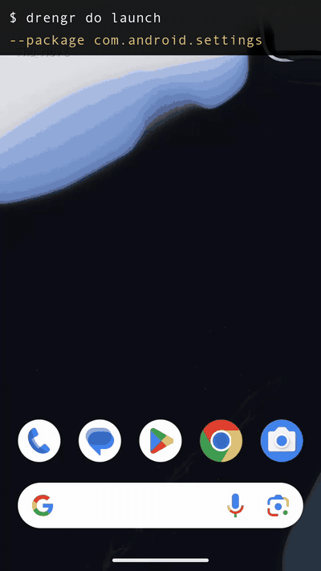

# drengr-hands

[](https://github.com/SharminSirajudeen/drengr-hands/actions/workflows/rust-ci.yml)
[](LICENSE)

**Eyes and hands for AI agents on Android and iOS.**

Your agent already has a brain. This gives it a device.



*Claude Code turning on dark mode through drengr 0.11.1 on an Android emulator. Recorded 5 Nov 2026; the pauses while the agent read each screen are cut.*

```bash
drengr look                    # see the screen: numbered elements + screenshot
drengr do tap --element 5      # act: tap / type / swipe / key
drengr query setup --headless  # boot an emulator or simulator if none is running
```

No API key. No account. No cloud. It talks to a local device over ADB (Android)
or `simctl` plus a 479-line Swift runner (iOS). No Appium, no WebDriverAgent.

## Drive it from your MCP client

```bash
claude mcp add drengr -- drengr mcp
```

Three tools: `drengr_look`, `drengr_do`, `drengr_query`. The loop is: look once,
then `do` repeatedly. Every `do` returns what changed (new elements, navigation,
crashes, network calls), so your agent knows what its last action actually did.

Your agent is the brain. It never needs a key of its own, because the decision
happens in the model you are already paying for.

## Or let it drive itself

```bash
export OPENAI_API_KEY=...        # or GEMINI / ANTHROPIC / GROQ / TOGETHER / FIREWORKS
drengr run --app com.example.app --task "log in with test@test.com"
```

Seven providers, plus `DRENGR_BASE_URL` for any OpenAI-compatible endpoint
(OpenRouter, LiteLLM, vLLM). Ollama runs it with no key and no account:

```bash
ollama pull qwen2.5vl:7b
export DRENGR_VISION_PROVIDER=ollama
drengr run --app com.example.app --task "add the first item to the cart"
```

The model has to accept images and emit strict JSON: the loop escalates to
vision when a screen is underlabelled. `qwen2.5vl:7b` is the tested default;
text-only or thinking-style models will fail to produce a parseable decision.

Simple instructions that name a visible element resolve without any model call
at all, so a lot of a run costs nothing.

It is your key and your bill, always. Nothing is proxied through us.

## Or a device you don't own

```bash
drengr run --cloud browserstack --device "Pixel 8" --os-version 14 \
  --app com.example.app --task "log in"
```

`--cloud` takes `browserstack`, `saucelabs`, `aws`, `lambdatest`, `perfecto`,
`kobiton`, or **any Appium hub URL**: a self-hosted grid, a vendor not on that
list, or `http://localhost:4723`. The named ones only exist so their hub URL and
credential env vars are filled in for you; underneath they are all the same
WebDriver path, so a provider we have never heard of works the same way.

## Let the app report its own traffic

Log-based capture (`logcat` on Android, `CFNetwork` on iOS) gives URLs, methods,
statuses and durations, never request headers, never bodies. To get those, the
app can report them itself:

```bash
drengr sdk-server        # listens on 127.0.0.1:7879
```

Anything inside the app that speaks the JSON protocol in `src/sdk/messages.rs`
can stream what it sees. Because it runs inside the process, it captures **above
TLS**: no proxy, no CA to install, and it survives certificate pinning, which is
where proxy-based tools stop working.

`drengr query network` tags every call with the source that saw it and states
what that source can and cannot observe, so a missing body reads as "not
reported" rather than "not sent".

## Tests in CI

```yaml
# drengr-tests.yml
app: com.example.app
tasks:
  - name: checkout
    task: add an item to the cart and reach the payment screen
```

```bash
drengr test drengr-tests.yml --format json
```

## How it works

Four steps, and only one of them needs a model:

| | |
|---|---|
| **Observe** | screenshot + accessibility tree, via ADB or the iOS runner |
| **Orient** | diff against the last screen: what appeared, what navigated, what crashed |
| **Decide** | your agent, or `drengr run`'s built-in loop |
| **Act** | tap, type, swipe, launch, deep-link, set location, grant permissions |

A screen costs ~300 tokens as a text scene instead of ~100KB as an image, so an
agent can watch a whole flow without burning its context on pixels.

## Everything it can do

40 actions and 17 queries. `drengr query capabilities` lists each one with its parameters,
an example and the platforms it runs on. All run on Android and iOS except where marked.

| | |
|---|---|
| **Touch** | `tap` `type` `clear_and_type` `long_press` `swipe` `swipe_with_velocity` `draw_path` `scroll_to_top` `scroll_to_bottom` `key` `back` `home` `go_home` |
| **Apps** | `launch` `launch_app` (by name) `list_installed_apps` `install` `uninstall` `terminate_app` `reset_app` `clear_app_data` (Android) `open_url` `deep_link` `spotlight_search` (iOS) `app_state` |
| **Device** | `set_location` `clear_location` `set_appearance` `set_orientation` `simulate_biometric` `pasteboard_set` `pasteboard_get` `grant_permission` `unlock` (Android) `start_recording` `stop_recording` `wait` |
| **Dialogs** | `alert_text` `alert_accept` `alert_dismiss` |
| **Queries** | `setup` `devices` `connect` `activity` `find` `ui_dump` `keyboard` `crash` `logcat` `network` `assert` `diff` `analyze` `explore` `session` `app_state` `capabilities` |

## What it can't do yet

- **Drive a physical iPhone from your own Mac.** iOS runs on the Simulator, and on real
  iPhones only through an Appium hub (`--cloud`: a vendor cloud or your own grid).
- **Run on Windows.** Release binaries are macOS and Linux only.
- **Serve MCP beyond your own machine.** `drengr mcp --http` listens on 127.0.0.1 only.

## Install

Prebuilt binaries for macOS (Apple Silicon, Intel) and Linux (x86_64, arm64), each with a
SHA-256 file, are on the [latest release](https://github.com/SharminSirajudeen/drengr-hands/releases/latest).
Unpack it and put `drengr` on your PATH. Or build from source:

```bash
cargo install --locked --git https://github.com/SharminSirajudeen/drengr-hands
```

Needs the Android SDK platform-tools for Android, and Xcode for iOS.
`drengr doctor` tells you what is missing.

npm (`npx drengr`) and drengr.dev/install.sh still serve 0.10.13, built from the older
drengr-community repository, until this repository's npm publishing is set up.

## Built by Drengr Analytics

Drengr Analytics is zero-instrumentation mobile analytics: it understands what
your app does without you writing tracking code, and redacts PII on the device
before anything leaves it. This is the actuation layer, open-sourced.
[drengr.dev](https://drengr.dev)

MIT.
